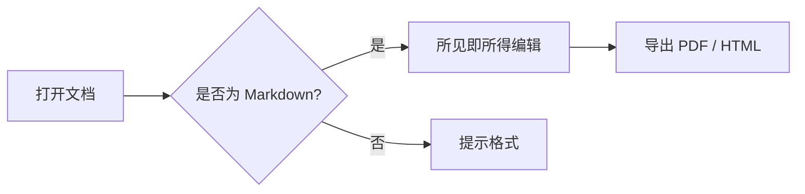
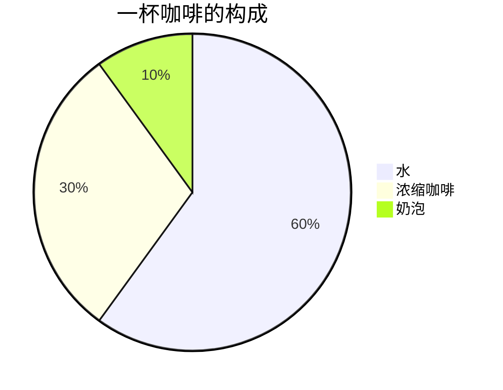

# MDPreview 功能演示

一个 **Typora 风格**的 macOS Markdown 所见即所得编辑器 —— 直接在渲染结果上编辑,所见即所得。

> 提示:这份文档本身就是一个活文档,你可以直接修改每一个部分试试。`Ctrl+/` 切换源码模式,`Ctrl+E` 导出 PDF。

## 行内语法

**加粗文本**、*斜体文本*、~~删除线~~、`行内代码`、[链接](https://markdown.example)、脚注不存在也能安全显示。

## 表格

| 语法 | 渲染 | 快捷键 |
| ---- | :--: | ----- |
| 表格 | ✓ | Ctrl+Alt+T |
| 代码块 | ✓ | Ctrl+Alt+C |
| 公式 | ✓ | Ctrl+Alt+M |

## 数学公式

行内公式:质能方程 $E = mc^2$ 与欧拉公式 $e^{i\pi} + 1 = 0$。

块级公式(高斯积分):

$$
\int_{-\infty}^{\infty} e^{-x^2} \, dx = \sqrt{\pi}
$$

## Mermaid 图表

点击图表可进入源码编辑,失焦自动重新渲染:





## 代码块

```swift
func 斐波那契(_ n: Int) -> Int {
    guard n > 1 else { return n }
    return 斐波那契(n - 1) + 斐波那契(n - 2)
}
print(斐波那契(10)) // 55
```

```python
def hello(name: str) -> str:
    return f"Hello, {name}!"
```

## 任务列表

- [x] 支持 Mermaid / KaTeX / 表格渲染
- [x] 单文件应用,像记事本一样简单
- [ ] 试试点击这里的复选框
- [ ] 试试 `Ctrl+/` 源码模式

## 引用与分割线

> 「简单,比简单更简单。」
>
> —— 一款编辑器的设计哲学

---

祝使用愉快!
